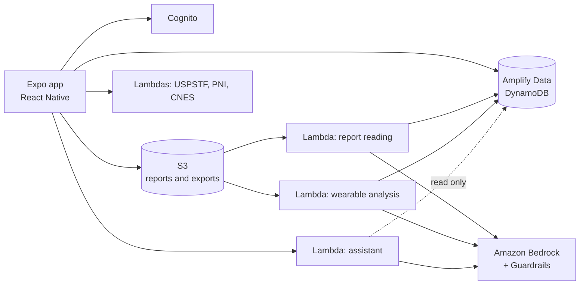

# SuaSaúde

[Português](README.md) · **English**

A health app (React Native + AWS) that brings lab results, prescriptions, medicines, appointments, vaccines and wearable data into one place, with AI that **reads lab reports** and **talks about the user's health** from the user's own data, always as informational support and never as a diagnosis.

> Capstone project (B.Sc. Computer Science), Instituto Mauá de Tecnologia (IMT), Brazil. Advisor: Prof. Robson Calvetti. The app's interface is in Brazilian Portuguese.

---

## What the app does

| Area | What is built |
|---|---|
| **AI lab-report reading** | The user attaches a PDF or photo of a lab report; a backend function extracts every result with Amazon Bedrock, normalises the analyte name (LOINC) and unit (UCUM), and stores structured rows that become per-analyte trend charts. |
| **Conversational assistant** | Answers questions about the user's own data (lab results, medicines, appointments, wearables), cites where each fact came from, verifies the answer before showing it, and can propose actions (opening a pre-filled appointment or reminder that the user confirms) and memories that are saved only if the user accepts. |
| **Wearables** | Imports the Samsung Health export or an Apple Health exporter's file (CSV/JSON/ZIP), builds daily series and generates a correlation analysis (e.g. sleep vs resting heart rate) narrated by Bedrock. |
| **Medicines** | Schedules, stock and push reminders, plus drug-interaction alerts from a curated, referenced dataset ([sources](docs/interacoes-medicamentosas.md), in Portuguese). |
| **Prevention and vaccination** | Preventive-screening recommendations (USPSTF) based on the profile, a vaccination card, campaigns from Brazil's Ministry of Health open data (PNI) and vaccination sites (CNES). |
| **Agenda and profile** | Appointments, a health profile, and terms of use and privacy policy under Brazil's LGPD. |

**How the AI is kept safe:** all health data is processed **inside the project's own AWS account** (Bedrock with Guardrails, created as code), never sent to third-party AI providers. The conversational AI only **reads** what the other pieces wrote; no answer is shown without a code-level check, and users can only reach their own files.

---

## Architecture



| Layer | Technologies |
|---|---|
| App | Expo (React Native), Expo Router, TypeScript, NativeWind, React Hook Form + Zod |
| Backend | AWS Amplify Gen 2 (backend as code), Cognito, DynamoDB, S3, Lambda (Node/TypeScript) |
| AI | Amazon Bedrock (Claude) with Guardrails; LOINC and UCUM vocabularies versioned in the repository |
| Quality | Jest (250+ test files across app and backend), ESLint, type checks, assistant evaluation runs (`scripts/avaliacao/`) |

The work was spec-driven: each screen has a `spec.md`, `plan.md` and `tasks.md` in [`specs/`](specs/), and the AI studies (provider choice, language rules, data schemas, decision log) live in [`estudos-ia/`](estudos-ia/) (in Portuguese).

---

## Team

| Name | Main area |
|---|---|
| Pedro Gabriel Oliveira Máximo | AI lab-report reading, conversational assistant, security and much of the app |
| Arturo Ochoa Garcia | Wearable data import and analysis |
| André Martinez de Souza | Development |
| Brunno Bernacchi de Souza | Development |
| Matheus Passari Nascimento | Development |

---

## Run it

Requires [Node.js](https://nodejs.org/) LTS and the **Expo Go** app on a phone (or an Android/iOS emulator).

```bash
git clone https://github.com/pgmaximo/trabalho_conclusao_curso.git
cd trabalho_conclusao_curso
npm install
npx expo start
```

Full validation (app and backend type checks, lint and tests):

```bash
npm run validate
```

The app uses a shared development backend on Amplify Gen 2; the committed `amplify_outputs.json` holds only public client configuration, never credentials. To run your own backend: `npm run amplify:sandbox`. Details in [`docs/aws-amplify.md`](docs/aws-amplify.md).

---

## Layout

```
src/          app: screens/, routes (app/), components, hooks, services and types
amplify/      backend as code: auth, data, storage and the Lambda functions (functions/)
__tests__/    app tests (Jest); backend tests sit next to each function
specs/        per-screen specifications (spec-driven development)
estudos-ia/   AI studies, decisions and measurements
docs/         technical notes, LGPD and the folder-conventions guide
scripts/      deployment, assistant evaluation and utilities
```

---

## License

Developed for academic purposes only, as the capstone project of Instituto Mauá de Tecnologia.
