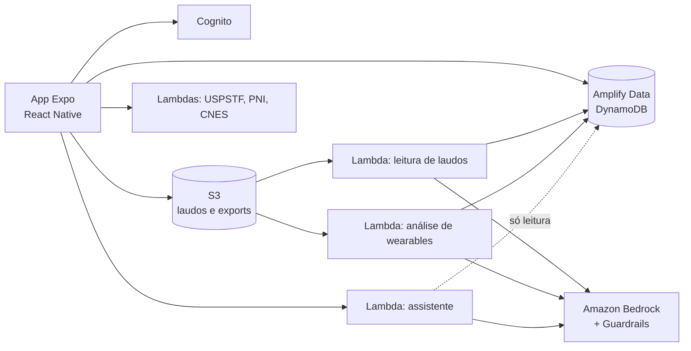

# SuaSaúde

**Português** · [English](README.en.md)

Aplicativo de saúde (React Native + AWS) que reúne exames, receitas, medicamentos, consultas, vacinas e dados de wearables num só lugar, com IA que **lê laudos de exames** e **conversa sobre a saúde do usuário** a partir dos dados dele, sempre como apoio informativo e nunca como diagnóstico.

> Trabalho de Conclusão de Curso de Ciência da Computação, Instituto Mauá de Tecnologia (IMT). Orientador: Prof. MSc. Dr. Robson Calvetti.

---

## O que o app faz

| Área | O que está construído |
|---|---|
| **Leitura de exames por IA** | O usuário anexa o PDF ou a foto de um laudo; uma função no backend extrai cada resultado com o Amazon Bedrock, normaliza o nome do analito (LOINC) e a unidade (UCUM), e grava linhas estruturadas que viram gráficos de evolução por analito. |
| **Assistente de conversa** | Responde perguntas sobre os dados do próprio usuário (exames, remédios, consultas, wearables), cita de onde tirou cada informação, verifica a resposta antes de mostrar e pode propor ações (abrir um agendamento ou um lembrete já preenchido, que o usuário confirma) e memórias que só são gravadas se o usuário aceitar. |
| **Wearables** | Importa o export do Samsung Health ou de um exportador do Apple Health (CSV/JSON/ZIP), consolida séries diárias e gera uma análise de correlações (ex.: sono e frequência cardíaca de repouso) narrada pelo Bedrock. |
| **Medicamentos** | Cadastro com horários, estoque e lembretes por notificação, mais alerta de interação medicamentosa a partir de um dataset curado e referenciado ([fontes](docs/interacoes-medicamentosas.md)). |
| **Prevenção e vacinação** | Recomendações de exames preventivos (USPSTF) conforme o perfil, carteira de vacinação, campanhas com dados abertos do Ministério da Saúde (PNI) e locais de vacinação (CNES). |
| **Agenda e perfil** | Consultas, perfil de saúde, termos de uso e política de privacidade conforme a LGPD. |

**Como a IA é mantida segura:** todo dado de saúde é processado **dentro da conta AWS do projeto** (Bedrock com Guardrails, criados como código), sem envio a provedores de IA de terceiros. A IA que conversa só **lê** o que as outras gravaram; nenhuma resposta é exibida sem passar por uma verificação em código, e o usuário só vê arquivos que são dele.

---

## Arquitetura



| Camada | Tecnologias |
|---|---|
| App | Expo (React Native), Expo Router, TypeScript, NativeWind, React Hook Form + Zod |
| Backend | AWS Amplify Gen 2 (backend como código), Cognito, DynamoDB, S3, Lambda (Node/TypeScript) |
| IA | Amazon Bedrock (Claude) com Guardrails; vocabulários LOINC e UCUM versionados no repositório |
| Qualidade | Jest (mais de 250 arquivos de teste entre app e backend), ESLint, checagem de tipos, rodadas de avaliação do assistente (`scripts/avaliacao/`) |

O processo foi guiado por especificação: cada tela tem `spec.md`, `plan.md` e `tasks.md` em [`specs/`](specs/), e os estudos de IA (provedor, regras de linguagem, esquemas de dados, decisões) estão em [`estudos-ia/`](estudos-ia/).

---

## Equipe

| Nome | Frente principal |
|---|---|
| Pedro Gabriel Oliveira Máximo | IA de leitura de exames, assistente de conversa, segurança e grande parte do app |
| Arturo Ochoa Garcia | Importação e análise de dados de wearables |
| André Martinez de Souza | Desenvolvimento |
| Brunno Bernacchi de Souza | Desenvolvimento |
| Matheus Passari Nascimento | Desenvolvimento |

---

## Como executar

Pré-requisitos: [Node.js](https://nodejs.org/) LTS e o app **Expo Go** no celular (ou um emulador Android/iOS).

```bash
git clone https://github.com/pgmaximo/suasaude.git
cd suasaude
npm install
npx expo start
```

Validação completa (tipos do app e do backend, lint e testes):

```bash
npm run validate
```

O app usa um backend de desenvolvimento compartilhado no Amplify Gen 2; o `amplify_outputs.json` versionado contém apenas configuração pública de cliente, nunca credenciais. Para subir um backend próprio: `npm run amplify:sandbox`. Detalhes em [`docs/aws-amplify.md`](docs/aws-amplify.md).

---

## Estrutura

```
src/          app: telas (screens/), rotas (app/), componentes, hooks, serviços e tipos
amplify/      backend como código: auth, data, storage e as funções Lambda (functions/)
__tests__/    testes do app (Jest); os do backend ficam junto de cada função
specs/        especificações por tela (spec-driven development)
estudos-ia/   estudos, decisões e medições das IAs
docs/         notas técnicas, LGPD e o guia de convenções de pastas
scripts/      deploy, avaliação do assistente e utilitários
```

O guia de convenções de cada pasta (com exemplos) está em [`docs/estrutura-de-pastas.md`](docs/estrutura-de-pastas.md).

---

## Referências bibliográficas

- ANDERSON, K.; BURFORD, O.; EMMERTON, L. *Mobile Health Apps to Facilitate Self-Care: A Qualitative Study of User Experiences*. PLOS ONE, 2016.
- LEE, J.-A. et al. *Effective behavioral intervention strategies using mobile health applications for chronic disease management: a systematic review*. BMC Medical Informatics and Decision Making, 2018.
- SPREADBURY, J. H. et al. *A Comprehensive Literature Search of Digital Health Technology Use in Neurological Conditions*. JMIR, 2022.
- NEGASH, S. et al. *Physicians' attitudes and acceptance towards artificial intelligence in medical care: a qualitative study in Germany*. Frontiers in Digital Health, 2025.

O projeto se alinha ao **ODS 3 da ONU** (saúde e bem-estar), apoiando o autocuidado e a prevenção.

---

## Licença

Projeto desenvolvido exclusivamente para fins acadêmicos, no âmbito do Trabalho de Conclusão de Curso do Instituto Mauá de Tecnologia.
